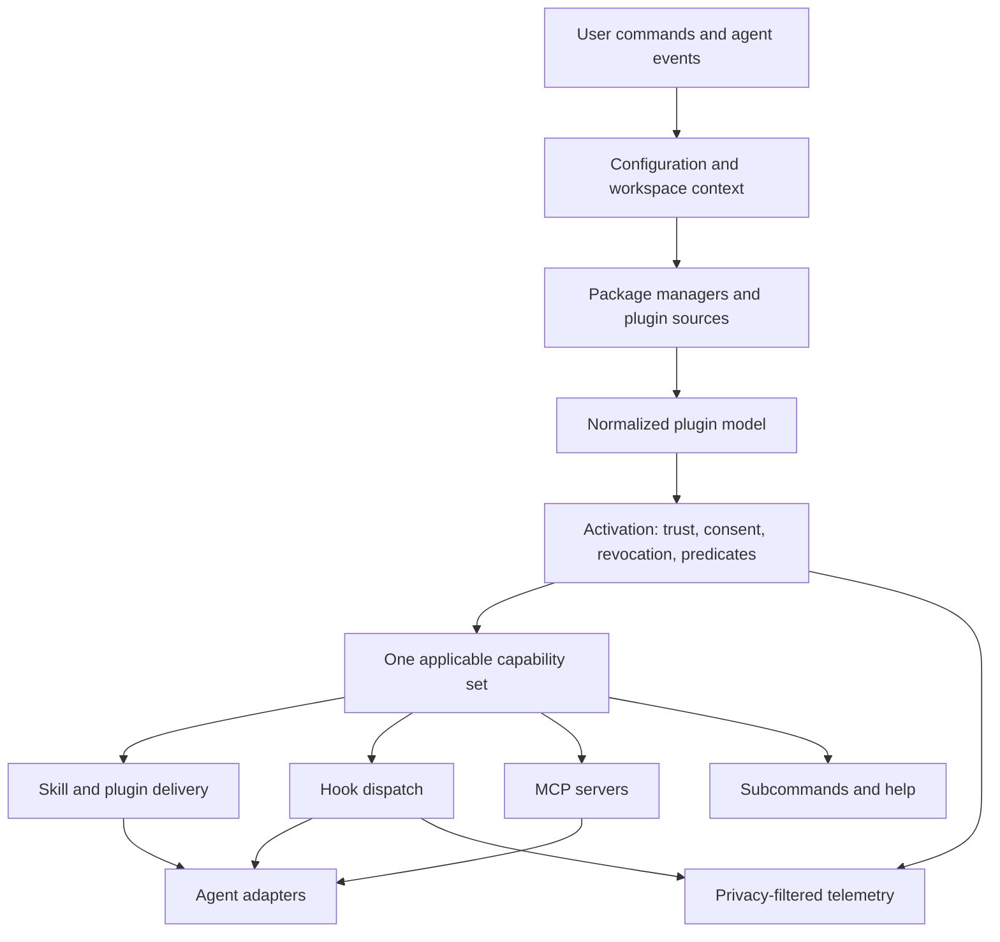

# System Architecture

Symposium brings ecosystem knowledge and tools into coding agents. Package
authors ship plugins beside their libraries; curated registries supply additional
plugins; users decide which dependency plugins may run. Symposium resolves the
workspace, selects applicable capabilities, and presents them through each
agent's supported interfaces.

## Components and boundaries

The core owns policy: configuration, validation, activation, audits, installation
ownership, and agent translation. The SDK owns shared types and the package-manager
protocol. A package manager owns ecosystem identity, workspace discovery, package
metadata, and acquisition. Cargo is one implementation, usable in process or
through the same protocol as an external manager. An agent adapter describes
independent skill, hook, MCP, and plugin capabilities; supporting one does not
imply the others.

A plugin source supplies executable content, not permission to run it. Curated
registries form explicit trust roots. A dependency shipping a manifest remains
untrusted until the user's enablement policy permits it. An audit is information
about a package, not consent. Cargo-package revocation prevents that package's activation even when an
otherwise valid enablement route exists; registry and workspace definitions
remain separate trust roots. Package-manager answers and imported
manifests pass through validation before becoming the runtime model.

## The shared resolution flow

1. Resolve startup directories and load user configuration once. Resolve the
   event or command directory to a workspace through the configured package managers.
2. Load normalized registry entries, explicitly selected plugins, workspace
   content, and dependency candidates. Keep failed-source evidence distinct from
   a healthy source returning no plugins.
3. Apply enablement, disablement, revocation, and predicates. Traverse chained
   references with canonical package identities and retain origin/context.
4. Project the resulting active graph into skills, hooks, MCP servers,
   subcommands, and help. These consumers share selection rules.
5. Acquire content at the refresh level the invocation permits. Deliver owned
   artifacts, or execute selected capabilities through their adapter.
6. Record only permitted observations when telemetry consent enables recording.

An agent event uses its valid payload directory for predicates and plugin
processes, falling back to the process directory when necessary. Package-manager
workspace context is shared within the invocation. A project-local enablement is
bound to its resolved absolute workspace root; it does not leak to another
workspace. Global enablement supplies content independently of the current
workspace while event-time gates still determine executable applicability.

## Lifecycle and failures

Initialization records the user's choices and registers Symposium's integration.
Manual sync can obtain consent and refresh content. Session start is the ordinary
refresh point; later hooks use cached discovery and recorded freshness inputs.
Hooks must return useful local output even when remote managers fail. A failed
or incomplete source cannot establish that previously installed content is stale.

Durable user choices, disposable caches, installation ownership, and optional
telemetry have different lifetimes. Configuration protection belongs to
[Configuration Loading](configuration-loading.md); source availability and
identity to [Package Managers](package-managers.md); cache validity to
[State and Caching](state-and-caching.md). Removal requires ownership evidence,
not merely an expected path.

## Correctness ownership

| System guarantee | Owning design and anchors |
| --- | --- |
| One consistent, consented capability graph | [Activation](activation.md): `A-activation-consent`, `A-activation-shared-graph` |
| Ecosystem identities and source failures retain their meaning | [Package Managers](package-managers.md): `A-pm-context-integrity` |
| Imported content respects package boundaries | [Plugin Model](plugin-model.md): `A-plugin-package-boundary` |
| Refresh and cleanup preserve user work | [Delivery](delivery.md): `A-delivery-owned-content`, `A-delivery-incomplete-sources` |
| Hook decisions reach agents within bounded execution | [Hooks](hooks.md): `A-hook-format-selection`, `A-hook-cancellation`, `A-hook-agent-response` |
| Package revocation overrides every route loading that package | [Audits](audits.md): `A-audit-revocation` |
| Telemetry records permitted data only after consent | [Telemetry](telemetry.md): `A-telemetry-consent`, `A-telemetry-data-boundary` |

These properties have one definition in their owning chapters. The overview
connects them without introducing a duplicate system-wide anchor.

## Design principles

Symposium should be easy to adopt and remove, preserve user repositories, use
existing package and agent standards, and support the union of agent capabilities.
Vendor neutrality does not require pretending that agent interfaces are identical.
Ecosystem maintainers should be able to provide knowledge without joining a
central plugin distribution service. Explicit consent and clear ownership make
that extensibility compatible with the safety and unobtrusive tenets.
